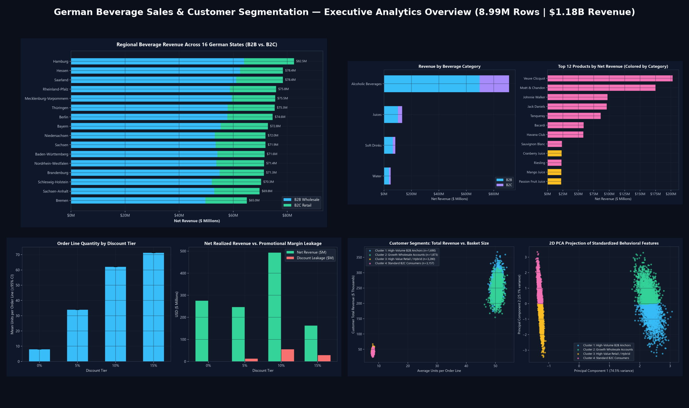
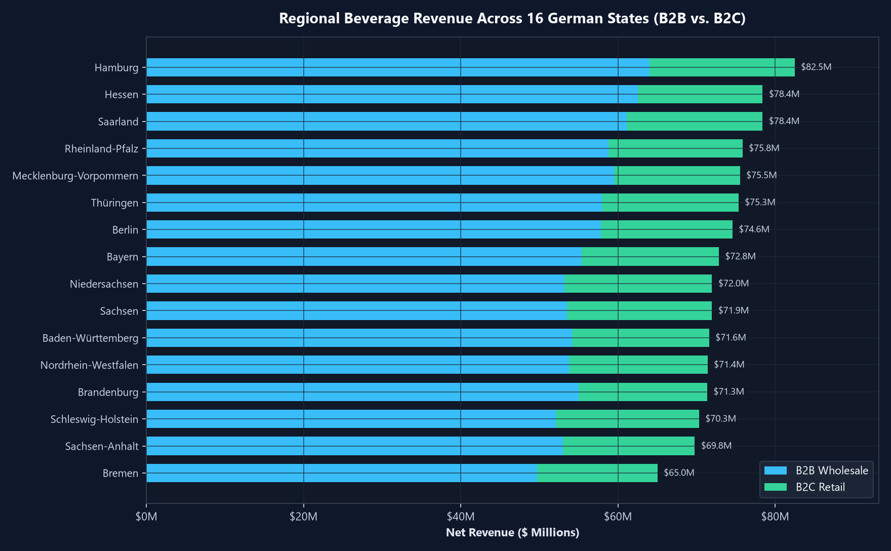
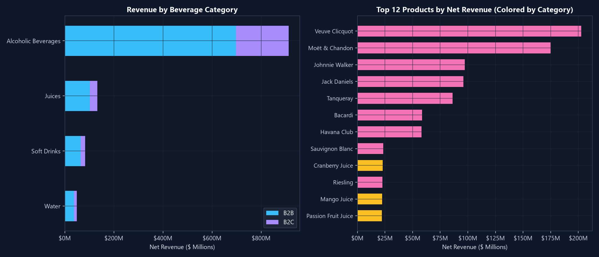
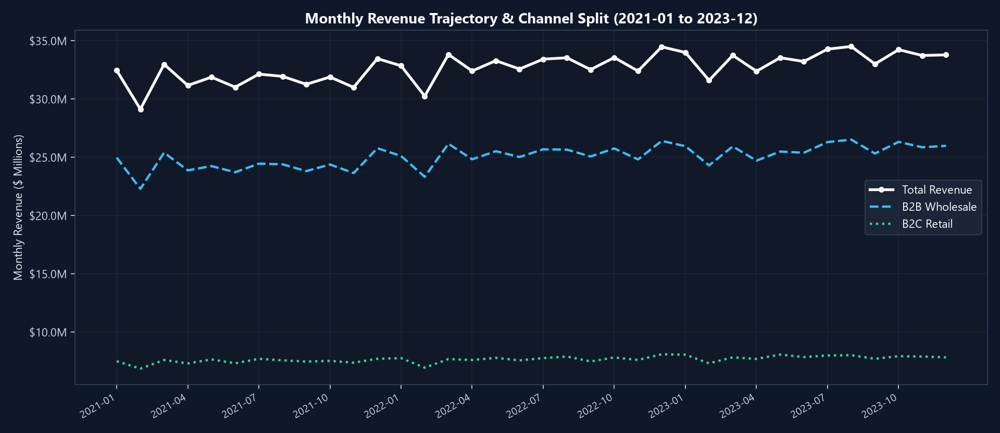
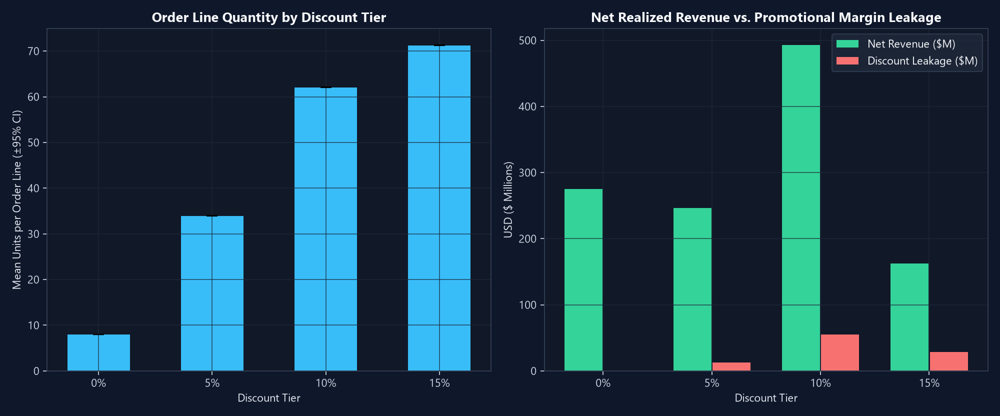
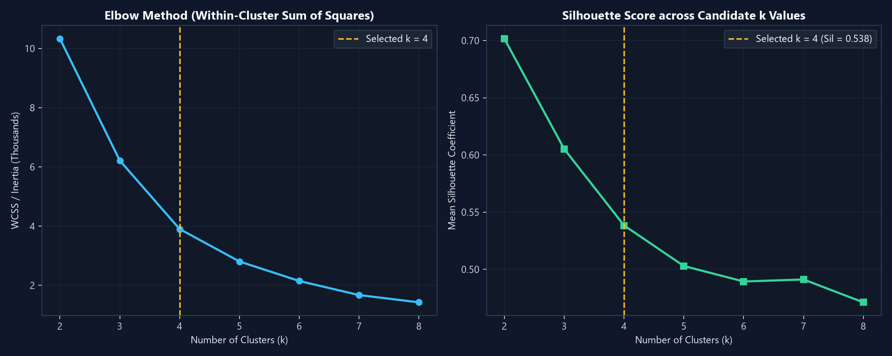
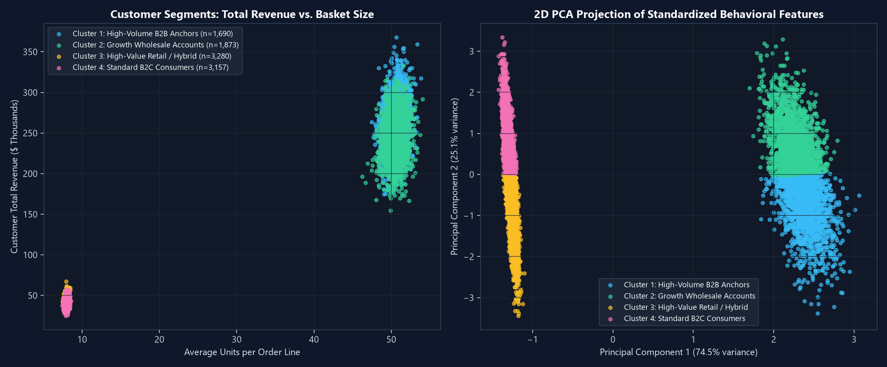

# Ventas de Bebidas en Alemania, Elasticidad de Precios y Segmentación K-Means++ (`8.99M` de Registros | Python, AG Grid)

> **Idioma:** [English (`README.md`)](README.md) | **Español**
>
> **Análisis Cuantitativo y de Machine Learning de Extremo a Extremo:** Agregación por bloques (*streaming*), estimación estadística de elasticidad de descuentos con intervalos de confianza al 95%, agrupamiento no supervisado **K-Means++**, **PCA 2D (SVD)** y dashboard interactivo bilingüe (**EN / ES**) en **AG Grid HTML5** sobre **8,999,910 transacciones** (**3,000,000 pedidos**, **10,000 clientes**, **$1.18B de ingresos netos** en **16 estados federados de Alemania**).



- **Dashboard Interactivo Bilingüe (EN/ES) en AG Grid HTML5:** [`index.html`](index.html)
- **Documentación en Inglés:** [`README.md`](README.md)
- **Fuente Oficial de Datos Kaggle (`752.7 MB`):** [Beverage Sales Dataset por Sebastian Willmann](https://www.kaggle.com/datasets/sebastianwillmann/beverage-sales/data)
- **Pipeline Reproducible en Python y Matplotlib:** [`src/beverage_analysis.py`](src/beverage_analysis.py)
- **Resumen Estadístico y Clústeres en JSON:** [`data/beverage_summary.json`](data/beverage_summary.json)

---

## Índice
1. [Alcance Analítico y Preguntas de Investigación](#1-alcance-analítico-y-preguntas-de-investigación)
2. [Conjunto de Datos y Esquema (8,999,910 Filas)](#2-conjunto-de-datos-y-esquema-8999910-filas)
3. [Flujo de Trabajo y Fórmulas Analíticas](#3-flujo-de-trabajo-y-fórmulas-analíticas)
4. [Análisis Exploratorio y Hallazgos Estadísticos](#4-análisis-exploratorio-y-hallazgos-estadísticos)
5. [Aprendizaje No Supervisado: Segmentación de Clientes K-Means++](#5-aprendizaje-no-supervisado-segmentación-de-clientes-k-means)
6. [Dashboard Interactivo Bilingüe en AG Grid HTML5](#6-dashboard-interactivo-bilingüe-en-ag-grid-html5)
7. [Síntesis Empírica y Elasticidad de Descuentos](#7-síntesis-empírica-y-elasticidad-de-descuentos)
8. [Conclusiones Analíticas Clave y Limitaciones Metodológicas](#8-conclusiones-analíticas-clave-y-limitaciones-metodológicas)
9. [Estructura del Repositorio y Verificación Reproducible](#9-estructura-del-repositorio-y-verificación-reproducible)

---

## 1. Alcance Analítico y Preguntas de Investigación

Este estudio empírico analiza **8,999,910 registros transaccionales sintéticos** distribuidos en **16 estados federados de Alemania (*Bundesländer*)**, cubriendo canales mayoristas (`B2B`) y minoristas (`B2C`) y **47 marcas** en 4 categorías (`Alcoholic Beverages`, `Juices`, `Soft Drinks` y `Water`).

Cinco preguntas estadísticas y estructurales guían la investigación:
1. **Dispersión Espacial y por Canal:** ¿Cómo divergen los ingresos netos y el volumen físico entre los 16 estados alemanes y entre los canales `B2B` frente a `B2C`?
2. **Concentración Monetaria vs. Paridad de Volumen:** ¿Qué tan pronunciada es la concentración de valor entre categorías cuando las unidades físicas son casi idénticas?
3. **Elasticidad Estadística por Nivel de Descuento:** Los tramos `B2B` de 5%, 10% y 15% generan una diferencia bruto-a-neto de **$96.41M**. ¿El salto del 10% al 15% produce una expansión proporcional en el tamaño del pedido con significancia estadística?
4. **Agrupamiento Conductual K-Means++:** ¿Pueden 4 variables estandarizadas por cliente recuperar regímenes conductuales estables en los **10,000 clientes únicos** mediante K-Means++ y PCA 2D?
5. **Exploración Reproducible sin Backend:** ¿Cómo pueden los analistas filtrar las **94 combinaciones Producto × Canal** y **32 combinaciones Estado × Canal** con cambio instantáneo **EN/ES**, gráficos SVG reactivos y exportación CSV?

---

## 2. Conjunto de Datos y Esquema (8,999,910 Filas)

Analiza el conjunto público [**Beverage Sales Dataset** en Kaggle (`sebastianwillmann/beverage-sales`)](https://www.kaggle.com/datasets/sebastianwillmann/beverage-sales/data) (`synthetic_beverage_sales_data.csv`, **752.7 MB**, período **1 de enero de 2021 – 30 de diciembre de 2023**), excluido del repositorio mediante `.gitignore` por superar el límite de 100 MB de GitHub.

| Columna | Tipo | Descripción | Resultado de Validación |
| :--- | :--- | :--- | :--- |
| `Order_ID` | `string` | Identificador único de pedido (`ORD1` – `ORD3000000`) | **3,000,000 pedidos únicos**, `0` nulos |
| `Customer_ID` | `string` | Identificador de cliente (`CUS1` – `CUS10000`) | **10,000 clientes únicos**, `0` nulos |
| `Customer_Type` | `category` | Canal: `B2B` (Mayorista) o `B2C` (Minorista) | 35.6% líneas B2B / 64.4% líneas B2C |
| `Product` | `category` | Marca específica de bebida (47 marcas) | `0` nulos |
| `Category` | `category` | `Alcoholic Beverages`, `Juices`, `Soft Drinks`, `Water` | 4 categorías equilibradas, `0` nulos |
| `Unit_Price` | `float64` | Precio unitario bruto (USD) previo al descuento | Rango: `$0.32` – `$158.03` |
| `Quantity` | `int64` | Unidades adquiridas en la línea de pedido | **208,241,121 unidades totales**, `0` nulos |
| `Discount` | `float64` | Tramo de descuento (`0.00`, `0.05`, `0.10`, `0.15`) | B2C = `0%`; B2B = `5%–15%` |
| `Total_Price` | `float64` | Ingreso neto realizado: `Unit_Price * Quantity * (1 - Discount)` | **$1,176,681,163.35 totales**, `0` nulos |
| `Region` | `category` | Estado alemán (`Hamburg`, `Bayern`, `Berlin`, etc. — 16 totales) | Caracteres UTF-8 validados (`ü`, `ä`) |
| `Order_Date` | `string` | Fecha de transacción (`YYYY-MM-DD`) | `2021-01-01` a `2023-12-30` (36 meses) |

---

## 3. Flujo de Trabajo y Fórmulas Analíticas

1. **Ingresos Brutos y Diferencial de Descuento:**
   $$\text{Ingreso Bruto} = \sum (\text{Unit\_Price}_i \times \text{Quantity}_i) = \$1,273,091,726.11$$
   $$\text{Diferencial por Descuentos} = \text{Ingreso Bruto} - \sum \text{Total\_Price}_i = \$96,410,562.76 \text{ (7.57\% del Bruto)}$$
2. **Conteo Vectorizado de Pedidos en $O(N)$:** Al estar ordenados de forma contigua por `Order_ID`, los pedidos únicos se cuentan en $O(N)$ sin tablas hash en memoria mediante `(ch["Order_ID"] != ch["Order_ID"].shift(1)).fillna(True)`.
3. **Vector Conductual Estandarizado ($N = 10{,}000$):** Se estandariza por puntaje Z el vector $[\text{Ingresos}_c, \text{Pedidos}_c, \text{Unidades/Línea}_c, \text{Descuento Medio}_c]$ antes del algoritmo K-Means++.

---

## 4. Análisis Exploratorio y Hallazgos Estadísticos

### 4.1 Desempeño Regional por Estado (`16` Estados)

- **Estados Líderes:** **Hamburg** encabeza los ingresos netos (**$82.47M**: `$64.01M` B2B + `$18.46M` B2C), seguido de **Hessen** (**$78.40M**) y **Saarland** (**$78.39M**).
- **Mayor Brecha Precio-Volumen:** **Bremen** ocupa el puesto 16 en ingresos (**$65.02M**) pese a registrar **13.19M de unidades** (más que Bayern o Berlin), debido a su mezcla de productos de menor precio unitario.

### 4.2 Concentración por Categoría y Principales Marcas

- Las cuatro categorías mueven volúmenes físicos casi idénticos (~**52.0M–52.1M de unidades**), pero **Alcoholic Beverages aporta $911.80M (77.49% del ingreso neto total)**, liderada por **Veuve Clicquot** (**$202.58M**) y **Moët & Chandon** (**$175.09M**). **Water** concentra **25.0% del volumen** (`52.08M` unidades) pero solo **4.16% de los ingresos** (`$48.91M`).

### 4.3 Trayectoria Mensual (`2021–2023`) y Elasticidad por Descuento



| Tramo de Descuento | Líneas | Media Unidades/Línea ($\pm 95\%$ IC) | Incremento vs. Tramo Previo | Ingreso Neto | Diferencial de Descuento |
| :--- | ---: | ---: | ---: | ---: | ---: |
| **0% (Base B2C)** | 5,795,405 | $8.00 \pm 0.0035$ | — | $275,061,551 | $0 |
| **5% (B2B Nivel 1)** | 1,438,899 | $33.93 \pm 0.0378$ | **+324.1%** | $246,116,304 | $12,953,671 |
| **10% (B2B Nivel 2)** | 1,384,589 | $62.05 \pm 0.0426$ | **+82.9%** | $492,967,760 | $54,774,118 |
| **15% (B2B Nivel 3)** | 381,017 | $71.26 \pm 0.0811$ | **+14.8% (Rendimiento Decreciente)** | $162,535,548 | **$28,682,774** |

---

## 5. Aprendizaje No Supervisado: Segmentación de Clientes K-Means++




Los dos primeros componentes principales explican **99.55% de la varianza conductual total** (`PC1 = 74.49%`, `PC2 = 25.06%`). Con $k = 4$ (`Silhouette = 0.5384`, `WCSS = 3,904.2`):

| Segmento de Clúster | Clientes ($n$) | Canal | Ingreso Medio | Pedidos Medios | Unidades / Línea | Descuento Medio | Eje Conductual Dominante |
| :--- | ---: | :--- | ---: | ---: | ---: | ---: | :--- |
| **Cluster 1: Anclas B2B de Alto Volumen** | 1,690 (16.9%) | 100% B2B | **$265,186** | 314.5 | 50.52 | 8.35% | Gran cesta + alta frecuencia mayorista (`PC1+`, `PC2+`) |
| **Cluster 2: Cuentas Mayoristas en Crecimiento** | 1,873 (18.7%) | 100% B2B | **$242,101** | 286.9 | 50.52 | 8.35% | Mismo tamaño de cesta (`50.52`), menor frecuencia (`286.9` vs. `314.5`) |
| **Cluster 3: Minoristas de Alta Frecuencia** | 3,280 (32.8%) | 100% B2C | **$44,702** | 313.5 | 8.00 | 0.00% | Canal minorista sin descuento, frecuencia alta (`313.5` pedidos) |
| **Cluster 4: Consumidores B2C Estándar** | 3,157 (31.6%) | 100% B2C | **$40,683** | 286.0 | 8.00 | 0.00% | Base minorista sin descuento (`286.0` pedidos) |

---

## 6. Dashboard Interactivo Bilingüe en AG Grid HTML5

Abre [`index.html`](index.html) en cualquier navegador para explorar el panel con cambio instantáneo **Inglés / Español (`EN / ES`)**, gráficos SVG reactivos a filtros y tablas **AG Grid Community** (`94` filas Producto × Canal y `32` filas Estado × Canal).

---

## 7. Síntesis Empírica y Elasticidad de Descuentos

- **Asimetría de Canal (`76.6%` B2B):** Las cuentas `B2B` representan el `35.6%` de las líneas pero generan **$901.62M (`76.6%`)** del ingreso neto por pedidos `6.3×` mayores (`50.52` vs. `8.00` unidades/línea).
- **Atenuación Marginal en el Tramo del `15%`:** Pasar del `5%` al `10%` aumenta la cantidad media por línea en **+82.9%**, mientras que subir del `10%` al `15%` solo aporta **+14.8%** (`62.05 → 71.26`) con un diferencial de descuento de **$28.68M**.

---

## 8. Conclusiones Analíticas Clave y Limitaciones Metodológicas

1. **Separación Ortogonal en `PCA 2D` (`99.55%`):** `PC1` (`74.49%`) capta el contraste estructural `B2B` frente a `B2C` y `PC2` (`25.06%`) aísla la frecuencia pura de compra (`~314` frente a `~286` pedidos).
2. **Limitaciones Empíricas del Conjunto:** El conjunto omite costo unitario (`COGS`) y flete por unidad (midiendo ingresos netos, no margen contable neto), presenta baja varianza entre categorías debido a su generación sintética (`~52.0M` unidades cada una) y refleja asignación observacional no experimental de descuentos.

---

## 9. Estructura del Repositorio y Verificación Reproducible

```powershell
# 1. Ejecutar el pipeline de streaming (8.99M filas) y regenerar gráficos Matplotlib (~22s)
uv run --with pandas --with numpy --with matplotlib python src/beverage_analysis.py

# 2. Ejecutar la suite automatizada de verificación HTML5, SVG, bilingüe y datos
node verify.mjs

# 3. Publicar como repositorio PÚBLICO independiente en GitHub (el CSV de 752.7 MB se excluye en .gitignore)
winget install --id Git.Git -e; winget install --id GitHub.cli -e
git init
git add .
git commit -m "Add 8.99M-row German Beverage Sales analytical study, bilingual EN/ES dashboard & K-Means++"
gh auth login
gh repo create beverage-sales-elasticity-and-segmentation --public --description "Streaming EDA, 95% CI discount elasticity & K-Means++ segmentation across 8.99M beverage transactions with bilingual EN/ES AG Grid workbench." --source=. --remote=origin --push
```
