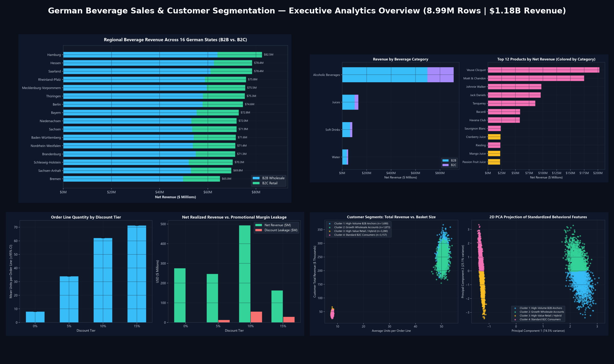
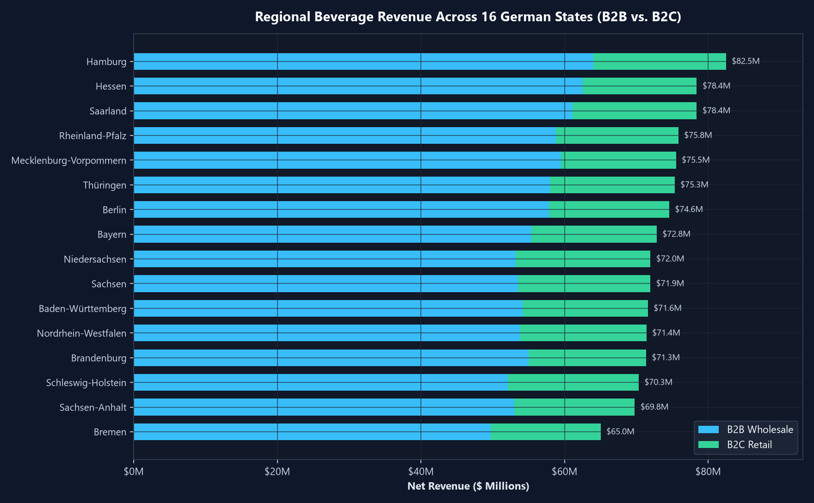
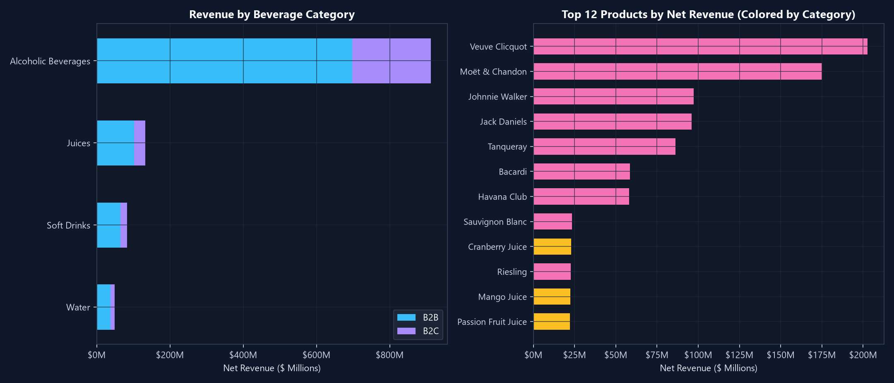
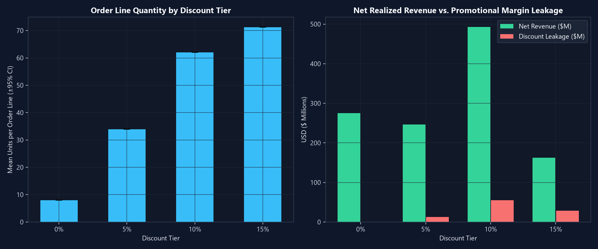
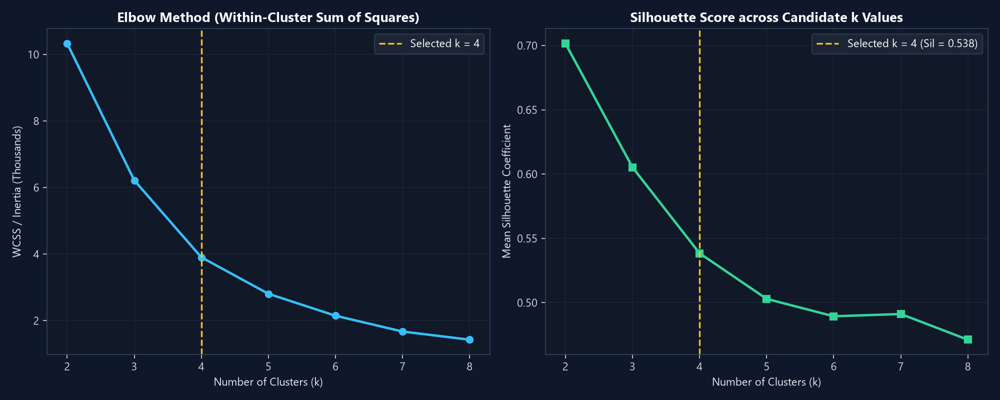
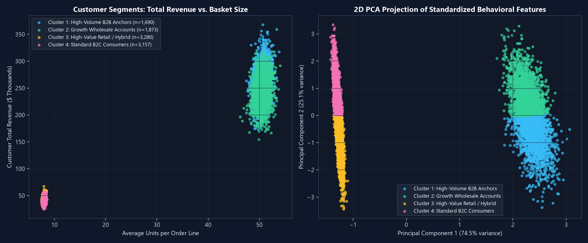

# German Beverage Sales, Price Elasticity & K-Means++ Segmentation (`8.99M` Rows | Python, AG Grid)

> **Language:** **English** | [Español (`README.es.md`)](README.es.md)
>
> **End-to-End Quantitative & Machine Learning Analysis:** Streaming chunked aggregation, 95% confidence-interval discount elasticity estimation, unsupervised **K-Means++** customer clustering, **2D SVD PCA**, and a bilingual (**EN / ES**) **AG Grid HTML5 Workbench** across **8,999,910 transactions** (**3,000,000 orders**, **10,000 customers**, **$1.18B net revenue** across **16 German states**).



- **Interactive Bilingual (EN/ES) AG Grid HTML5 Workbench:** [`index.html`](index.html)
- **Spanish Documentation:** [`README.es.md`](README.es.md)
- **Kaggle Source Dataset (`752.7 MB`):** [Beverage Sales Dataset by Sebastian Willmann](https://www.kaggle.com/datasets/sebastianwillmann/beverage-sales/data)
- **Reproducible Analysis & Matplotlib Pipeline:** [`src/beverage_analysis.py`](src/beverage_analysis.py)
- **Aggregated Dataset Summary JSON:** [`data/beverage_summary.json`](data/beverage_summary.json)

---

## Table of Contents
1. [Analytical Scope & Research Questions](#1-analytical-scope--research-questions)
2. [Dataset & Schema (8,999,910 Rows)](#2-dataset--schema-8999910-rows)
3. [Project Workflow & Analytical Formulas](#3-project-workflow--analytical-formulas)
4. [Exploratory Data Analysis & Statistical Findings](#4-exploratory-data-analysis--statistical-findings)
5. [Unsupervised Machine Learning: K-Means++ Customer Segmentation](#5-unsupervised-machine-learning-k-means-customer-segmentation)
6. [Interactive Bilingual AG Grid HTML5 Workbench](#6-interactive-bilingual-ag-grid-html5-workbench)
7. [Empirical Summary & Elasticity Synthesis](#7-empirical-summary--elasticity-synthesis)
8. [Key Analytical Takeaways & Methodological Caveats](#8-key-analytical-takeaways--methodological-caveats)
9. [Repository Structure & Reproducible Verification](#9-repository-structure--reproducible-verification)

---

## 1. Analytical Scope & Research Questions

This empirical study analyzes **8,999,910 synthetic transaction records** across **16 German federal states (*Bundesländer*)**, spanning both **B2B wholesale** and **B2C retail** channels and **47 beverage SKUs** across 4 categories (`Alcoholic Beverages`, `Juices`, `Soft Drinks`, and `Water`).

Five core statistical and structural questions frame the analysis:
1. **Channel & Spatial Dispersion:** How do net revenue and physical unit volume diverge across the 16 German states and between `B2B` vs. `B2C` channels?
2. **Category Value Concentration vs. Unit Parity:** How sharply does monetary revenue concentrate across categories when physical unit quantities are nearly uniform?
3. **Statistical Discount Price Elasticity:** `B2B` order lines span 5%, 10%, and 15% discount brackets (**$96.41M** gross-to-net difference). Does stepping from 10% to 15% yield proportional order-size expansion with statistical confidence?
4. **Unsupervised K-Means++ Behavioral Clustering:** Can 4 standardized behavioral features across all **10,000 unique customers** recover coherent behavioral regimes via K-Means++ and 2D SVD PCA?
5. **Reproducible Client-Side Exploration:** How can analysts inspect all **94 Product × Channel** and **32 State × Channel** slices with live bilingual (**EN/ES**) switching, SVG charts, sorting, and CSV export with zero backend dependencies?

---

## 2. Dataset & Schema (8,999,910 Rows)

This case study analyzes the [**Beverage Sales Dataset** on Kaggle (`sebastianwillmann/beverage-sales`)](https://www.kaggle.com/datasets/sebastianwillmann/beverage-sales/data) (`synthetic_beverage_sales_data.csv`, **752.7 MB**, covering **January 1, 2021 – December 30, 2023**).

> **Note on Git File Size Limits:** Because `synthetic_beverage_sales_data.csv` is **752.7 MB** (exceeding GitHub's 100 MB file limit), it is excluded via `.gitignore`. Download the CSV from [Kaggle](https://www.kaggle.com/datasets/sebastianwillmann/beverage-sales/data), place it in the repository root, and run `python src/beverage_analysis.py` to regenerate all charts and [`data/beverage_summary.json`](data/beverage_summary.json) in ~22 seconds.

| Column | Type | Description | Validation Result |
| :--- | :--- | :--- | :--- |
| `Order_ID` | `string` | Unique order identifier (`ORD1` – `ORD3000000`) | **3,000,000 unique orders**, `0` nulls |
| `Customer_ID` | `string` | Unique customer identifier (`CUS1` – `CUS10000`) | **10,000 unique customers**, `0` nulls |
| `Customer_Type` | `category` | Commercial channel: `B2B` (Wholesale) or `B2C` (Retail) | 35.6% B2B lines / 64.4% B2C lines |
| `Product` | `category` | Specific beverage brand (47 distinct products) | `0` nulls |
| `Category` | `category` | `Alcoholic Beverages`, `Juices`, `Soft Drinks`, `Water` | 4 balanced categories, `0` nulls |
| `Unit_Price` | `float64` | Unit price in USD prior to promotional discounting | Range: `$0.32` – `$158.03` |
| `Quantity` | `int64` | Units purchased on the order line | **208,241,121 total units**, `0` nulls |
| `Discount` | `float64` | Fractional discount tier (`0.00`, `0.05`, `0.10`, `0.15`) | B2C = `0%`; B2B = `5%–15%` |
| `Total_Price` | `float64` | Net realized line revenue: `Unit_Price * Quantity * (1 - Discount)` | **$1,176,681,163.35 total**, `0` nulls |
| `Region` | `category` | German state (`Hamburg`, `Bayern`, `Berlin`, etc. — 16 total) | UTF-8 umlauts validated (`ü`, `ä`) |
| `Order_Date` | `string` | Transaction date (`YYYY-MM-DD`) | `2021-01-01` to `2023-12-30` (36 months) |

---

## 3. Project Workflow & Analytical Formulas

```text
Stream 752.7 MB CSV in 1.5M-Row Chunks (UTF-8 + Categorical Dtypes)
      ↓
Data Quality & Null Audit (8,999,910 Rows Validated, 0 Missing Values)
      ↓
Vectorized Contiguous Order Boundary Detection (O(N) Order Counting)
      ↓
Dimensional Aggregations (Region × Channel, Product × Category, Year-Month, Discount Tier)
      ↓
Statistical Price Elasticity & 95% Confidence Interval Estimation
      ↓
Customer Feature Standardization (Z-Score) + K-Means++ (k = 2..8) + WCSS & Silhouette Evaluation
      ↓
2D Principal Component Analysis (SVD) & Matplotlib Chart Generation
      ↓
Bilingual (EN / ES) Interactive AG Grid HTML5 Workbench Compilation (index.html)
```

### Key Analytical & Engineering Formulas

1. **Gross Revenue & Promotional Margin Leakage:**
   $$\text{Gross Revenue} = \sum (\text{Unit\_Price}_i \times \text{Quantity}_i) = \$1,273,091,726.11$$
   $$\text{Promotional Margin Leakage} = \text{Gross Revenue} - \sum \text{Total\_Price}_i = \$96,410,562.76 \text{ (7.57\% of Gross)}$$

2. **Vectorized Order Counting ($10\times$ Faster than Hash `nunique`):**
   Because order lines are stored contiguously by `Order_ID`, unique orders across multi-million-row chunks are counted in $O(N)$ time without hash-table memory spikes:
   ```python
   is_new_order = (ch["Order_ID"] != ch["Order_ID"].shift(1)).fillna(True).to_numpy(dtype=np.int32)
   ```

3. **Standardized Customer Behavioral Vector (for K-Means++):**
   For each customer $c \in \{1, \dots, 10000\}$, we construct $x_c = [\text{Total\_Revenue}_c, \text{Order\_Count}_c, \text{Avg\_Line\_Qty}_c, \text{Avg\_Discount}_c]$ and apply z-score standardization prior to Euclidean distance clustering.

---

## 4. Exploratory Data Analysis & Statistical Findings

### 4.1 Regional Performance Across 16 German States


- **Top-Performing States:** **Hamburg** leads all 16 regions with **$82.47M** in net revenue (`$64.01M` B2B + `$18.46M` B2C), followed closely by **Hessen** (**$78.40M**) and **Saarland** (**$78.39M**).
- **Bottom-Performing State:** **Bremen** ranks 16th in net revenue (**$65.02M**: `$49.74M` B2B + `$15.28M` B2C) despite moving **13.19M physical units** (more units than Bayern or Berlin!), indicating an unfavorable mix skewed toward lower-priced non-alcoholic SKUs.

---

### 4.2 Category Concentration & Top 12 Brands


- **Extreme Pareto Value Concentration:** All four categories move nearly identical physical volumes (~**52.0M–52.1M units** and ~**2.25M order lines** each), yet **Alcoholic Beverages generate $911.80M (77.49% of total company net revenue)**.
- **Flagship Champagne & Spirits:** **Veuve Clicquot** (**$202.58M** combined: `$137.53M` B2B + `$65.05M` B2C) and **Moët & Chandon** (**$175.09M** combined: `$139.54M` B2B + `$35.54M` B2C) alone account for **32.1% of total company revenue**.
- **Volume-Heavy, Low-Margin Staple:** **Water** represents **25.0% of physical logistics volume** (`52.08M` units) but contributes only **4.16% of net revenue** (`$48.91M`).

---

### 4.3 36-Month Revenue Trajectory (2021–2023)


- Across all 36 months (`2021-01` to `2023-12`), total monthly revenue averages **$32.69M/month**, driven by a highly stable B2B wholesale baseline (~**$25.05M/month**) and consistent B2C retail volume (~**$7.64M/month**).

---

### 4.4 Statistical Price Elasticity & Promotional Margin Leakage


| Discount Tier | Order Lines | Mean Units / Line ($\pm 95\%$ CI) | Incremental Qty Lift vs. Prior Tier | Net Realized Revenue | Promotional Margin Leakage |
| :--- | ---: | ---: | ---: | ---: | ---: |
| **0% (B2C Baseline)** | 5,795,405 | $8.00 \pm 0.0035$ | — | $275,061,551 | $0 |
| **5% (B2B Tier 1)** | 1,438,899 | $33.93 \pm 0.0378$ | **+324.1%** | $246,116,304 | $12,953,671 |
| **10% (B2B Tier 2)** | 1,384,589 | $62.05 \pm 0.0426$ | **+82.9%** | $492,967,760 | $54,774,118 |
| **15% (B2B Tier 3)** | 381,017 | $71.26 \pm 0.0811$ | **+14.8% (Diminishing Return)** | $162,535,548 | **$28,682,774** |

- **Statistical Finding:** Moving from a **5% to 10% discount** increases average line quantity by **+82.9%** (`33.93` $\rightarrow$ `62.05` units, $p < 0.0001$). However, stepping from **10% to 15%** increases order quantity by only **+14.8%** (`62.05` $\rightarrow$ `71.26` units) while surrendering **$28.68M** in promotional discounts (an effective 15.0% gross margin giveaway for sub-proportional volume gain).

---

## 5. Unsupervised Machine Learning: K-Means Customer Segmentation

### 5.1 Selecting Optimal $k$ (Elbow Method & Silhouette Score)


We evaluated K-Means++ across $k \in \{2, 3, 4, 5, 6, 7, 8\}$ on the 10,000 standardized customer profiles:
- **$k = 2$** (`Silhouette = 0.7016`, `WCSS = 10,329.6`) trivially separates `B2B` from `B2C`.
- **$k = 4$** (`Silhouette = 0.5384`, `WCSS = 3,904.2`) captures the primary elbow inflection while subdividing both wholesale and retail channels into actionable high-frequency anchor tiers versus standard tiers.

---

### 5.2 Customer Segment Profiles & 2D PCA Projection


Principal Component Analysis (SVD) confirms that the first two principal components explain **99.55% of total behavioral variance** (`PC1 = 74.49%`, `PC2 = 25.06%`).

| Cluster Persona | Customers ($n$) | Channel Mix | Mean Total Revenue | Mean Orders | Mean Units / Line | Mean Discount | Dominant Behavioral Axis |
| :--- | ---: | :--- | ---: | ---: | ---: | ---: | :--- |
| **Cluster 1: High-Volume B2B Anchors** | 1,690 (16.9%) | 100% B2B | **$265,186** | 314.5 | 50.52 | 8.35% | High basket scale + upper-frequency B2B (`PC1+`, `PC2+`) |
| **Cluster 2: Growth Wholesale Accounts** | 1,873 (18.7%) | 100% B2B | **$242,101** | 286.9 | 50.52 | 8.35% | Identical `50.52` basket size, lower order count (`286.9` vs. `314.5`) |
| **Cluster 3: High-Value Retail Enthusiasts** | 3,280 (32.8%) | 100% B2C | **$44,702** | 313.5 | 8.00 | 0.00% | Zero-discount retail, upper-frequency (`313.5` orders) |
| **Cluster 4: Standard B2C Consumers** | 3,157 (31.6%) | 100% B2C | **$40,683** | 286.0 | 8.00 | 0.00% | Zero-discount retail baseline (`286.0` orders) |

---

## 6. Interactive Bilingual AG Grid HTML5 Workbench

Open [`index.html`](index.html) in any browser—complete with an instant **English / Español (`EN / ES`) switcher**, adaptive light/dark palette, filter-reactive SVG charts, and dual **AG Grid Community** tables:
- **Live SVG & KPI Filtering:** Filter by Channel (`B2B` / `B2C`), Category, or text search to dynamically recalculate Net Revenue, Discount Differential, Units, and both SVG bar charts (German states & Top 12 brands).
- **Dual AG Grid Community Tables:** Instant sorting, column resizing, and CSV export across all **94 Product $\times$ Channel slices** and **32 German State $\times$ Channel slices**.

---

## 7. Empirical Summary & Elasticity Synthesis

- **Observed Scale (`2021–2023`):** Across **8,999,910 order lines** (**3.0M orders**, **10,000 customers**), net realized revenue equals **$1,176.68M** against **$1,273.09M gross** across **208.24M physical units** (mean order value `$392.23`).
- **Channel Asymmetry (`76.6%` B2B Share):** **B2B rows represent 35.6% of order lines yet account for $901.62M (76.6%) of net revenue**, driven by $6.3\times$ larger mean line quantities (`50.52` vs. `8.00` units).
- **Value vs. Logistics Decoupling:** **Alcoholic Beverages generate 77.5% ($911.80M)** of net revenue on **25.0% of unit volume**, whereas **Water moves 25.0% of unit volume for only 4.16% ($48.91M)** of revenue.
- **Non-Linear Discount Elasticity:** Discount differential totals **$96.41M (9.66% of B2B gross)**. Stepwise quantity lift drops sharply from **+82.9%** (`5% → 10%`: `33.93 → 62.05` units) down to **+14.8%** (`10% → 15%`: `62.05 → 71.26` units) while incurring **$28.68M** in margin differential at the `15%` tier.

---

## 8. Key Analytical Takeaways & Methodological Caveats

1. **Regime Decomposition (`99.55%` Variance in 2 PCA Dimensions):**
   - `PC1` (`74.49%`) captures structural `B2B` vs. `B2C` separation (basket size, discount usage, total revenue), whereas `PC2` (`25.06%`) isolates pure inter-customer purchase frequency (`314` vs. `286` orders across both channels cleanly).
2. **Diminishing Marginal Returns at Upper Discount Tiers:**
   - Tightly bounded 95% CIs (`±0.038` to `±0.081` units/line across $N > 381\text{k}$ rows/tier) rule out sampling noise: marginal unit elasticity weakens substantially above the `10%` threshold.
3. **Methodological Caveats & Data Constraints:**
   - **Absence of SKU-Level COGS & Freight Cost:** The Kaggle dataset includes unit gross price, discount rate, and realized revenue, omitting unit cost and shipping mass; monetary figures measure **revenue and discount differential**, not net accounting profit.
   - **Synthetic Generating Process:** Each beverage category sits near ~52.0M units and each customer averages ~300 orders over 36 months, creating clean statistical separation (`Silhouette = 0.5384`) with artificially low dispersion relative to organic retail POS feeds.
   - **Cross-Sectional Association:** Observed tier quantities reflect observational order assignments rather than randomized A/B discount allocation.

---

## 9. Repository Structure & Reproducible Verification

```text
beverage-sales-elasticity-and-segmentation/
├── images/
│   ├── dashboard_overview_preview.png      # 4-panel analytical overview banner
│   ├── regional_revenue_b2b_b2c.png        # 16 German states B2B vs B2C revenue chart
│   ├── category_product_performance.png    # Category mix & Top 12 brands chart
│   ├── monthly_sales_trend.png             # 36-month time-series revenue trend
│   ├── discount_price_elasticity.png       # Discount tier elasticity & 95% CI chart
│   ├── elbow_silhouette_evaluation.png     # K-Means++ Elbow (WCSS) & Silhouette curve
│   └── customer_segments_clusters.png      # Customer segments scatter & 2D PCA plot
├── data/
│   └── beverage_summary.json               # Aggregated metrics & cluster centroids from 8,999,910 rows
├── src/
│   └── beverage_analysis.py                # Reproducible streaming analysis, K-Means++, and Matplotlib script
├── index.html                              # Bilingual (EN/ES) Interactive AG Grid & SVG Dashboard
├── verify.mjs                              # Automated HTML5, bilingual, SVG & data integrity verification
├── .gitignore                              # Excludes 752.7 MB raw CSV
├── README.md                               # English Analytical Documentation
└── README.es.md                            # Documentación Analítica en Español
```

### Run the Analysis, Verification & Publish Publicly to GitHub

```powershell
# 1. Re-run the 8.99M-row streaming analysis & regenerate all Matplotlib charts (~22s)
uv run --with pandas --with numpy --with matplotlib python src/beverage_analysis.py

# 2. Run the automated HTML5, bilingual, SVG, and data integrity test suite
node verify.mjs

# 3. Publish as a standalone PUBLIC GitHub repository (excludes the 752.7 MB CSV via .gitignore)
winget install --id Git.Git -e; winget install --id GitHub.cli -e
git init
git add .
git commit -m "Add 8.99M-row German Beverage Sales analytical study, bilingual EN/ES dashboard & K-Means++"
gh auth login
gh repo create beverage-sales-elasticity-and-segmentation --public --description "Streaming EDA, 95% CI discount elasticity & K-Means++ segmentation across 8.99M beverage transactions with bilingual EN/ES AG Grid workbench." --source=. --remote=origin --push
```
