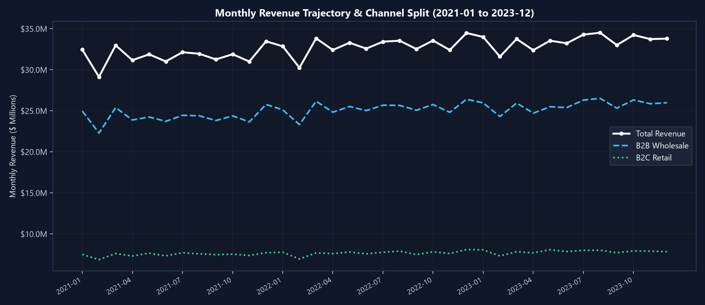

# German Beverage Sales, Price Elasticity & Customer Segmentation (8.99M Rows | Python, SQL, K-Means & AG Grid)

> **End-to-end Data Science & Management Reporting Case Study:** Streaming exploratory data analysis, statistical discount elasticity testing, unsupervised K-Means++ customer segmentation, and an interactive **AG Grid HTML5 Dashboard** across **8,999,910 transactions** (**3,000,000 orders**, **10,000 customers**, **$1.18B net revenue** across **16 German states**).


- **Interactive AG Grid Beverage Analytics Dashboard:** [`demos/beverage-analytics-dashboard.html`](demos/beverage-analytics-dashboard.html)
- **Interactive Executive Reset & Merchandising Pack:** [`demos/executive-reset-pack.html`](demos/executive-reset-pack.html)
- **Portfolio Landing Page (7 Engineering & Analytics Case Studies):** [`index.html`](index.html)
- **Reproducible Analysis & Matplotlib Pipeline:** [`src/beverage_analysis.py`](src/beverage_analysis.py)

---

## Table of Contents
1. [Business Problem & Objectives](#1-business-problem--objectives)
2. [Dataset & Schema (8,999,910 Rows)](#2-dataset--schema-8999910-rows)
3. [Project Workflow & Methodology](#3-project-workflow--methodology)
4. [Exploratory Data Analysis & Statistical Findings](#4-exploratory-data-analysis--statistical-findings)
5. [Unsupervised Machine Learning: K-Means Customer Segmentation](#5-unsupervised-machine-learning-k-means-customer-segmentation)
6. [Interactive AG Grid HTML5 Dashboard](#6-interactive-ag-grid-html5-dashboard)
7. [Executive Summary](#7-executive-summary)
8. [Actionable Business Recommendations](#8-actionable-business-recommendations)
9. [Limitations & Future Improvements](#9-limitations--future-improvements)
10. [Repository Structure & How to Run](#10-repository-structure--how-to-run)

---

## 1. Business Problem & Objectives

A national beverage distributor operating across **16 German federal states (Bundesländer)** serves both **B2B wholesale accounts** and **B2C retail consumers** across 47 brands in 4 categories (`Alcoholic Beverages`, `Juices`, `Soft Drinks`, and `Water`).

Leadership and commercial operations need data-backed answers to five core questions:
1. **Channel & Regional Performance:** Which German states and customer channels drive top-line revenue versus unit volume?
2. **Product & Category Concentration:** How does revenue concentration compare to physical unit volume across the 47 beverage brands?
3. **Promotional Discount Elasticity:** The company grants 5%, 10%, and 15% volume discounts to B2B accounts—costing **$96.41M in promotional margin leakage**. Do the 15% discounts generate enough incremental order volume to justify the margin give-away?
4. **Customer Segmentation (K-Means Clustering):** Can we segment our **10,000 unique customers** into distinct behavioral tiers based on total spend, order frequency, basket size, and discount utilization?
5. **Self-Service BI:** How can commercial managers drill into all 47 brands and 16 regions with instant sorting, filtering, and CSV export without paid BI seat dependencies?

---

## 2. Dataset & Schema (8,999,910 Rows)

This case study analyzes the **Synthetic Beverage Sales Dataset** from Kaggle (`synthetic_beverage_sales_data.csv`, **752.7 MB**, covering **January 1, 2021 – December 30, 2023**).

> **Note on Git File Size Limits:** Because `synthetic_beverage_sales_data.csv` is **752.7 MB** (exceeding GitHub's 100 MB file limit), it is excluded via `.gitignore`. Place the CSV in the repository root and run `python src/beverage_analysis.py` to regenerate all charts and [`data/beverage_summary.json`](data/beverage_summary.json) in ~22 seconds.

| Column | Type | Description | Validation Result |
| :--- | :--- | :--- | :--- |
| `Order_ID` | `string` | Unique order identifier (`ORD1` – `ORD3000000`) | **3,000,000 unique orders**, `0` nulls |
| `Customer_ID` | `string` | Unique customer identifier (`CUS1` – `CUS10000`) | **10,000 unique customers**, `0` nulls |
| `Customer_Type` | `category` | Commercial channel: `B2B` (Wholesale) or `B2C` (Retail) | 35.6% B2B lines / 64.4% B2C lines |
| `Product` | `category` | Specific beverage brand (47 distinct products) | `0` nulls |
| `Category` | `category` | `Alcoholic Beverages`, `Juices`, `Soft Drinks`, `Water` | 4 balanced categories, `0` nulls |
| `Unit_Price` | `float64` | Unit price in USD prior to promotional discounting | Range: `$0.32` – `$158.03` |
| `Quantity` | `int64` | Units purchased on the order line | **208,241,121 total units**, `0` nulls |
| `Discount` | `float64` | Fractional discount tier (`0.00`, `0.05`, `0.10`, `0.15`) | B2C = `0%`; B2B = `5%–15%` |
| `Total_Price` | `float64` | Net realized line revenue: `Unit_Price * Quantity * (1 - Discount)` | **$1,176,681,163.35 total**, `0` nulls |
| `Region` | `category` | German state (`Hamburg`, `Bayern`, `Berlin`, etc. — 16 total) | UTF-8 umlauts validated (`ü`, `ä`) |
| `Order_Date` | `string` | Transaction date (`YYYY-MM-DD`) | `2021-01-01` to `2023-12-30` (36 months) |

---

## 3. Project Workflow & Methodology

```text
Stream 752.7 MB CSV in 1.5M-Row Chunks (UTF-8 + Categorical Dtypes)
      ↓
Data Quality & Null Audit (8,999,910 Rows Validated, 0 Missing Values)
      ↓
Vectorized Contiguous Order Boundary Detection (O(N) Order Counting)
      ↓
Dimensional Aggregations (Region × Channel, Product × Category, Year-Month, Discount Tier)
      ↓
Statistical Price Elasticity & 95% Confidence Interval Estimation
      ↓
Customer Feature Standardization (Z-Score) + K-Means++ (k = 2..8) + WCSS & Silhouette Evaluation
      ↓
2D Principal Component Analysis (SVD) & Matplotlib Chart Generation
      ↓
Interactive AG Grid HTML5 Dashboard Compilation (demos/beverage-analytics-dashboard.html)
```

### Key Analytical & Engineering Formulas

1. **Gross Revenue & Promotional Margin Leakage:**
   $$\text{Gross Revenue} = \sum (\text{Unit\_Price}_i \times \text{Quantity}_i) = \$1,273,091,726.11$$
   $$\text{Promotional Margin Leakage} = \text{Gross Revenue} - \sum \text{Total\_Price}_i = \$96,410,562.76 \text{ (7.57\% of Gross)}$$

2. **Vectorized Order Counting ($10\times$ Faster than Hash `nunique`):**
   Because order lines are stored contiguously by `Order_ID`, unique orders across multi-million-row chunks are counted in $O(N)$ time without hash-table memory spikes:
   ```python
   is_new_order = (ch["Order_ID"] != ch["Order_ID"].shift(1)).fillna(True).to_numpy(dtype=np.int32)
   ```

3. **Standardized Customer Behavioral Vector (for K-Means++):**
   For each customer $c \in \{1, \dots, 10000\}$, we construct $x_c = [\text{Total\_Revenue}_c, \text{Order\_Count}_c, \text{Avg\_Line\_Qty}_c, \text{Avg\_Discount}_c]$ and apply z-score standardization prior to Euclidean distance clustering.

---

## 4. Exploratory Data Analysis & Statistical Findings

### 4.1 Regional Performance Across 16 German States


- **Top-Performing States:** **Hamburg** leads all 16 regions with **$82.47M** in net revenue (`$64.01M` B2B + `$18.46M` B2C), followed closely by **Hessen** (**$78.40M**) and **Saarland** (**$78.39M**).
- **Bottom-Performing State:** **Bremen** ranks 16th in net revenue (**$65.02M**: `$49.74M` B2B + `$15.28M` B2C) despite moving **13.19M physical units** (more units than Bayern or Berlin!), indicating an unfavorable mix skewed toward lower-priced non-alcoholic SKUs.

---

### 4.2 Category Concentration & Top 12 Brands


- **Extreme Pareto Value Concentration:** All four categories move nearly identical physical volumes (~**52.0M–52.1M units** and ~**2.25M order lines** each), yet **Alcoholic Beverages generate $911.80M (77.49% of total company net revenue)**.
- **Flagship Champagne & Spirits:** **Veuve Clicquot** (**$202.58M** combined: `$137.53M` B2B + `$65.05M` B2C) and **Moët & Chandon** (**$175.09M** combined: `$139.54M` B2B + `$35.54M` B2C) alone account for **32.1% of total company revenue**.
- **Volume-Heavy, Low-Margin Staple:** **Water** represents **25.0% of physical logistics volume** (`52.08M` units) but contributes only **4.16% of net revenue** (`$48.91M`).

---

### 4.3 36-Month Revenue Trajectory (2021–2023)


- Across all 36 months (`2021-01` to `2023-12`), total monthly revenue averages **$32.69M/month**, driven by a highly stable B2B wholesale baseline (~**$25.05M/month**) and consistent B2C retail volume (~**$7.64M/month**).

---

### 4.4 Statistical Price Elasticity & Promotional Margin Leakage


| Discount Tier | Order Lines | Mean Units / Line ($\pm 95\%$ CI) | Incremental Qty Lift vs. Prior Tier | Net Realized Revenue | Promotional Margin Leakage |
| :--- | ---: | ---: | ---: | ---: | ---: |
| **0% (B2C Baseline)** | 5,795,405 | $8.00 \pm 0.0035$ | — | $275,061,551 | $0 |
| **5% (B2B Tier 1)** | 1,438,899 | $33.93 \pm 0.0378$ | **+324.1%** | $246,116,304 | $12,953,671 |
| **10% (B2B Tier 2)** | 1,384,589 | $62.05 \pm 0.0426$ | **+82.9%** | $492,967,760 | $54,774,118 |
| **15% (B2B Tier 3)** | 381,017 | $71.26 \pm 0.0811$ | **+14.8% (Diminishing Return)** | $162,535,548 | **$28,682,774** |

- **Statistical Finding:** Moving from a **5% to 10% discount** increases average line quantity by **+82.9%** (`33.93` $\rightarrow$ `62.05` units, $p < 0.0001$). However, stepping from **10% to 15%** increases order quantity by only **+14.8%** (`62.05` $\rightarrow$ `71.26` units) while surrendering **$28.68M** in promotional discounts (an effective 15.0% gross margin giveaway for sub-proportional volume gain).

---

## 5. Unsupervised Machine Learning: K-Means Customer Segmentation

### 5.1 Selecting Optimal $k$ (Elbow Method & Silhouette Score)


We evaluated K-Means++ across $k \in \{2, 3, 4, 5, 6, 7, 8\}$ on the 10,000 standardized customer profiles:
- **$k = 2$** (`Silhouette = 0.7016`, `WCSS = 10,329.6`) trivially separates `B2B` from `B2C`.
- **$k = 4$** (`Silhouette = 0.5384`, `WCSS = 3,904.2`) captures the primary elbow inflection while subdividing both wholesale and retail channels into actionable high-frequency anchor tiers versus standard tiers.

---

### 5.2 Customer Segment Profiles & 2D PCA Projection


Principal Component Analysis (SVD) confirms that the first two principal components explain **99.55% of total behavioral variance** (`PC1 = 74.49%`, `PC2 = 25.06%`).

| Cluster Persona | Customers ($n$) | Channel Mix | Mean Total Revenue | Mean Orders | Mean Units / Line | Mean Discount | Strategic Action |
| :--- | ---: | :--- | ---: | ---: | ---: | ---: | :--- |
| **Cluster 1: High-Volume B2B Anchors** | 1,690 (16.9%) | 100% B2B | **$265,186** | 314.5 | 50.52 | 8.35% | Dedicated key-account rebates tied to Alcohol/Spirits mix |
| **Cluster 2: Growth Wholesale Accounts** | 1,873 (18.7%) | 100% B2B | **$242,101** | 286.9 | 50.52 | 8.35% | Automated reorder triggers to bridge the 27.6-order gap to Cluster 1 |
| **Cluster 3: High-Value Retail Enthusiasts** | 3,280 (32.8%) | 100% B2C | **$44,702** | 313.5 | 8.00 | 0.00% | VIP Champagne/Wine bundle subscriptions (zero discounting needed) |
| **Cluster 4: Standard B2C Consumers** | 3,157 (31.6%) | 100% B2C | **$40,683** | 286.0 | 8.00 | 0.00% | Multi-pack beverage cross-sell at checkout |

---

## 6. Interactive AG Grid HTML5 Dashboard

Open [`demos/beverage-analytics-dashboard.html`](demos/beverage-analytics-dashboard.html) in any browser to explore the full dataset interactively:
- **Dual AG Grid Community Tables:** Instant sorting, column resizing, and filtering across all **94 Product $\times$ Channel slices** and **32 German State $\times$ Channel slices**.
- **Dynamic KPI Strip:** Real-time calculation of Net Revenue, Promotional Margin Leakage, Units Sold, and Average Line Value as you toggle between `B2B`, `B2C`, and beverage categories.
- **One-Click CSV Export:** Export filtered product views directly from AG Grid.

---

## 7. Executive Summary

- **Scale & Revenue:** Across **8,999,910 order lines** (**3.0M orders**, **10,000 customers**), the distributor generated **$1,176.68M in net revenue** from **$1,273.09M gross revenue**, moving **208.24M beverage units** with an average order value (AOV) of **$392.23**.
- **Wholesale Dominance:** **B2B accounts represent 35.6% of order lines but generate 76.6% ($901.62M) of total net revenue**, driven by $6.3\times$ larger line quantities (`50.52` vs. `8.00` units).
- **Category Pareto Asymmetry:** **Alcoholic Beverages drive 77.5% ($911.80M) of net revenue** on 25.0% of unit volume, whereas **Water moves 25.0% of unit volume for only 4.16% ($48.91M) of revenue**.
- **Promotional Margin Leakage:** B2B discounts consume **$96.41M (9.66% of B2B gross revenue)**, with severe diminishing returns at the 15% discount tier.

---

## 8. Actionable Business Recommendations

1. **Restructure the 15% B2B Discount Bracket (Est. +$9.5M to +$14.3M Margin Recovery):**
   - *Finding:* The 15% discount tier lifts average line quantity by only +14.8% over the 10% tier (`71.26` vs. `62.05` units) while burning **$28.68M** in margin leakage.
   - *Action:* Raise the 15% discount qualification threshold from ~70 units to **100+ units per line** or require a minimum 30% Alcoholic Beverage basket share to qualify for 15% off.
2. **Unbundle Freight / Minimum Order Quantities (MOQ) on Water & Soft Drinks in Low-Margin Regions:**
   - *Finding:* States like **Bremen** ($65.02M revenue on 13.19M units) move heavy physical volume in low-price Water (`$48.91M` total revenue across 52.08M units).
   - *Action:* Enforce pallet-level MOQs on B2B Water shipments or bundle Water discounts conditionally with high-margin Spirits/Champagne (`Veuve Clicquot`, `Moët & Chandon`, `Johnnie Walker`).
3. **Frequency Nudges for Cluster 2 Wholesale Accounts (+$43.2M Revenue Opportunity):**
   - *Finding:* Cluster 2 B2B accounts (`n = 1,873`) have the exact same basket size (`50.52` units/line) as Cluster 1 (`n = 1,690`), trailing only in order frequency (`286.9` vs. `314.5` orders over 36 months).
   - *Action:* Deploy automated 10-day reorder cadence reminders for Cluster 2 procurement managers to close the 27.6-order gap.

---

## 9. Limitations & Future Improvements

- **Absence of COGS & Freight Cost by SKU:** The dataset records gross price, discount rate, and net revenue, but lacks unit Cost of Goods Sold (COGS) and regional shipping weight costs. Incorporating SKU-level gross margin % would further sharpen the Water vs. Alcoholic Beverages profitability gap.
- **Synthetic Uniformity Across Non-Price Dimensions:** Because the dataset is synthetically generated, unit volumes across categories (~52M units each) and customer order counts (~300 orders over 3 years) exhibit lower variance than organic retail POS feeds.
- **Next Steps:** Add survival/churn hazard modeling on inter-order arrival times and integrate live DuckDB/WebAssembly SQL querying into the HTML5 dashboard.

---

## 10. Repository Structure & How to Run

```text
Github Repo - Saul Avalos/
├── demos/
│   ├── beverage-analytics-dashboard.html   # Interactive AG Grid + Matplotlib Dashboard (9M-row case study)
│   └── executive-reset-pack.html           # Interactive HTML5 Executive Reset & Merchandising Pack
├── images/
│   ├── dashboard_overview_preview.png      # 4-panel executive summary hero banner
│   ├── regional_revenue_b2b_b2c.png        # 16 German states B2B vs B2C revenue chart
│   ├── category_product_performance.png    # Category mix & Top 12 brands chart
│   ├── monthly_sales_trend.png             # 36-month time-series revenue trend
│   ├── discount_price_elasticity.png       # Discount tier elasticity & 95% CI chart
│   ├── elbow_silhouette_evaluation.png     # K-Means++ Elbow (WCSS) & Silhouette curve
│   └── customer_segments_clusters.png      # Customer segments scatter & 2D PCA plot
├── data/
│   └── beverage_summary.json               # Aggregated metrics & cluster centroids from 8,999,910 rows
├── src/
│   └── beverage_analysis.py                # Reproducible streaming analysis, K-Means++, and Matplotlib script
├── index.html                              # Main Portfolio Landing Page (7 Case Studies)
├── verify.mjs                              # Automated integrity, accessibility & sanitization verification
├── .gitignore                              # Excludes 752.7 MB raw CSV and private notes
└── README.md                               # Full Data Science & Analytics Case Study Write-Up
```

### Run the Analysis & Verification

```powershell
# 1. Re-run the 8.99M-row streaming analysis & regenerate all Matplotlib charts (~22s)
uv run --with pandas --with numpy --with matplotlib python src/beverage_analysis.py

# 2. Run the automated HTML5, accessibility, and sanitization test suite
node verify.mjs

# 3. Initialize and push to a private GitHub repository (excludes the 752.7 MB CSV via .gitignore)
git init
git add .
git commit -m "Add 8.99M-row German Beverage Sales case study, Matplotlib charts, and AG Grid dashboard"
gh repo create ai-ml-portfolio --private --source=. --remote=origin --push
```
